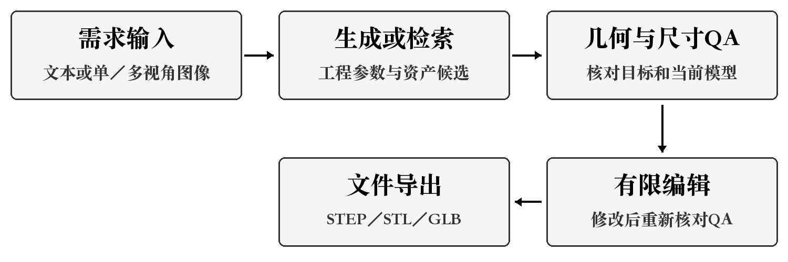

# SimpleCADforDSH课程项目启动与计划报告

## 1 项目概述

SimpleCADforDSH是面向DeepSeek Harness的智能参数化CAD生成检索插件，服务机械与工业设计专业学生、初级设计人员及有模型复用需求的小型团队。项目针对简单零件反复建模、尺寸修改和历史资产查找的操作成本，拟把需求输入、生成检索、质量检查、有限编辑与导出连接成可重复演示的流程。需求判断来自课堂讨论，尚需代表性用户样例检验其适用性。[S1]

项目将机械设计的尺寸与特征约束、数学与几何中的实体拓扑、AI的语义和图像理解，以及软件工程的接口、测试和配置管理结合。学生可沿参数和脚本理解模型形成；初级设计人员可复用常见结构并核对改型结果；小型团队可依据来源、版本和尺寸选择已有资产。课程阶段以支撑板、法兰、盒体和轴套等限定对象验证价值，不由个别样例推断复杂工业设计普遍可自动完成。

仓库已提供文本生成工具、参数读写、QA和导出代码。静态核查显示，可编辑参数取自工程描述与脚本PARAMS字典，不能从任意STEP恢复完整设计历史；watertight检查使用几何有效性与体积信息，仍须用异常几何验证。文本与图像检索、有限编辑和各项AT的完成状态以实际记录为准，代码入口存在不等于课程功能已验收。[S6]

图1 项目目标流程。有限编辑后重新核对当前模型与QA；箭头表示目标数据流，各环节按对应用户故事验收。

## 2 项目预启动

### 2.1 项目动机与差异化定位

支撑板、法兰等零件有重复的尺寸输入和特征操作，适合用参数模板降低重复劳动；已有模型是否适用，还需检查孔位、尺寸、来源与版本。因此项目同时处理生成与检索，以同一零件贯通参数修改、模型加载和质量核对。预期收益应按相同任务、相同质量标准计时验证，不能只比较一次成功生成所需的时间。

表1 相关工具与项目定位比较

| 对象 | 官方公开能力或本项目目标 | 本项目的选择与边界 |
| --- | --- | --- |
| FreeCAD | 参数化建模、Python扩展及实体操作[S8] | 复用成熟建模知识与文件交换能力，迁移范围按清单验收 |
| Onshape FeatureScript MCP | 连接AI助手编写、测试和调试可追溯的参数化特征[S12] | “自然语言到可编辑CAD”已有同类探索，不能据此宣称独创或效果领先 |
| build123d | Python参数化实体建模框架[S9] | 作为实现基础，输入约束、检索、面板状态及验收仍由团队完成 |
| SimpleCADforDSH | 拟在Harness中连接生成、资产复用、QA、有限编辑与导出 | 聚焦课程固定零件闭环，不建设完整通用CAD或企业级PDM |

本项目的特色定位为Harness中的工程流程整合：参数、资产元数据、模型与QA在同一工作流中交接，降低上下文切换。官方能力比较仅说明产品定位，不代表已经完成对各软件的同条件性能评测；本期不以从头研发几何内核或训练大模型作为创新前提。

预期用户吸引点是能看到尺寸、可修改参数和失败原因，而非只得到不可解释的模型文件。例如支撑板生成后修改孔径，应重新核对孔贯穿和外形尺寸；检索命中相似件后，应先检查规格及来源再复用。这样可把“生成了什么”和“为何可用”同时交给使用者判断。上述效果仍以课程样例验证，不作为商业推广承诺。

### 2.2 智能化路径与初步需求

基础路径把文本或图像需求转为结构化工程描述，明确单位、长宽高、孔径与约束，再调用建模能力生成实体。缺尺度、厚度不明或多视图矛盾时应请求补充，不以默认猜测充当正确尺寸。检索路径返回相似候选及来源、规格和版本，供用户选择加载；视觉相似度只能辅助排序，不能证明工程适用性。

目标沿用G1—G5：G1覆盖文本及单、多视角生成；G2覆盖文本与图像检索复用；G3显示几何与尺寸检查；G4提供清单内有限编辑；G5实现可恢复的固定剧本。US01—US25保留稳定编号，讨论二AT是故事验收依据，阶段目标另行核对。早期“最多6项编辑能力”是讨论一设想，须与后续US13—US22协调，由PO确认，不能静默删减故事。[S1][S2]

### 2.3 数据与资源可行性

拟以团队自建的参数模型及有权使用的公开资产准备样例，覆盖四类零件、单多视图、尺寸冲突、缺尺度、损坏输入和异常几何。模型、图片、标签、来源、版本及目标尺寸须能对应。当前跟踪的models目录仅有占位文件，不能据此认定已有可验收资产库；样例准备是开工前置工作，企业敏感库不作为首期交付依赖。[S6]

模型或权重接入须核查代码与文件可获得性、许可、运行资源及固定输入推理，再验证与插件、QA的交接。检索资产来源与生成模型训练数据分别记录，未知字段如实显示。优先使用现有设备和开源建模基础；显存、API额度、环境差异和输入质量仍可能阻塞。备用样例只用于恢复演示，不能替代实时能力验收；具体样例和资源清单交4.2及4.5维护。[S5]

### 2.4 项目选择与经济决策

比较三条路线：A人工CAD、B扩展已有插件、C自研或训练生成模型。A初始投入较低但重复任务主要耗费人工；B复用现有代码，仍需集成、复核及返工；C额外依赖数据、训练与部署。依据已有插件和六天约束，拟沿用B作为交付路径，C作为增强候选；最终取舍同时考虑质量、可解释性、资源与课程学习目标。

第2章与4.4共用情景XZJ-ECO-01：人工折算60元/小时，A每任务总人工30分钟；B初始60小时、每任务含复核返工10分钟及推理1元；C初始200小时和计算现金1000元、每任务含复核返工8分钟及推理0.5元。成本分别为30N、3600+11N、13000+8.5N，N为同类合格任务数，不是故事数。参数均为分析假设，不是报价、工资、实测收益或已批准预算。[E1]

B相对A自190个任务起不高于A；C与B在3760个任务时相等。200任务时三者为6000、5800、14700元，B仅节省200元，含初始投入后净节省人工6.67小时；若B人工增至15分钟，回收点升至258任务。故经济性取决于复用量与复核成本，不能由采用AI直接推定。刘子轩在4.4展开现金与机会成本及敏感性；实际六天预算另按WBS和获批资源估算，不套用60或200小时。[E1]

后续计时拟从需求与输入齐备开始，到模型符合相同验收条件结束，分别记录操作、等待、复核与返工，并保存失败尝试。只有交付质量相当的任务才比较成本；不能把人工路线的完整建模与插件路线的一次推理相比较。若出现维护、接口或训练失败费用，需增加对应项并重新评估，不能机械外推长期收益。

### 2.5 进度与潜在风险

现有计划为三个两天迭代，开发日历未确定时使用第1—6天。首迭代六名开发成员有效容量72人时、任务66人时，其中常诚和刘子轩各12小时满载，6小时余量分散于其余成员。讨论四重估85点不能自动改变原任务工时；风险应对22人时还需逐项去重。短周期的主要风险是关键人员与接口阻塞，以及生成效果、尺寸一致性、资产样例、环境与QA规则不足，须优先验证依赖而非平均分配余量。[S3][S4][S5]

## 3 项目启动

### 3.1 制定项目章程

项目经理与PO由许祖嘉兼任，李健博任Scrum Master，六名开发成员沿用原小组。章程以G1—G5、验收证据和资源边界约束授权；产品优先级由PO管理，新增费用或课程硬性目标调整须取得相应确认。开发期限、签署与批准状态据实维护，不以11月2日分稿期限代替开发结束日期。[S1][S11]

表2 项目章程

| 要素 | 项目约定与生效条件 |
| --- | --- |
| 项目名称 | SimpleCADforDSH 面向DeepSeek Harness的智能参数化CAD生成检索插件 |
| 目的与交付 | 降低限定零件建模及复用的操作成本；交插件、模型和检索样例、测试证据、演示与使用说明及管理材料 |
| 成功条件 | G1—G5及对应AT分别有证据；四类零件按阶段要求核验；STEP可外部读取，STL、GLB可加载；遗留项有接收决定 |
| 范围与排除 | US01—US25及确认的编辑清单；不纳入完整通用CAD、敏感企业库、通用几何修复和从零训练承诺 |
| 里程碑 | 第2天评审G1—G3；第4天评审G4；第6天总验收G1—G5并归档。目标未达成时记录缺口、影响及处置决定 |
| 职责与权限 | 许祖嘉统筹资源、范围、优先级与验收；李健博组织Scrum及阻塞协调；各组主责实现、自测与交接 |
| 人力与容量 | 八人名义48人日；六名开发成员名义36人日。首迭代有效72人时，PO与SM管理工时单列，不将名义容量视为净开发工时 |
| 假设与依赖 | demo和Harness环境可复现；模型服务额度、合法样例、几何内核与文件交换环境可用；开工前验证，不成立时评估计划影响 |
| 主要风险 | 生成及检索效果、单位与尺寸、关键人员满载、跨模块接口、显存环境及验收输入不足 |
| 预算与批准 | 优先现有资源；新增API、算力等费用上限、承担方式、批准人和实际开发起止日期待确认，不代填签署 |
| 接收与变更 | PO依据故事AT及阶段目标接收增量；教师按课程要求评价；影响范围、费用或里程碑的变更须经评估确认后同步基线 |

### 3.2 干系人识别

干系人分级用于确定参与强度，属于本项目管理判断，不代表支持态度或已经发生的满意度调查。教师的课程要求、目标用户的适用性反馈和平台的接口许可分别处理。讨论一列出的企业安全部门、资助方和反对者，未有明确参与记录时按潜在干系人维护，不虚设已达成的合作。[S1]

表3 干系人登记与参与安排

| 干系人 | 影响力／关注度 | 关注点与责任 | 拟参与方式及管理策略 |
| --- | --- | --- | --- |
| 许祖嘉，项目经理／PO | 高／高 | 价值、范围、容量和接收 | 迭代关口确认；决定优先级、变更和验收结论 |
| 李健博，SM | 高／高 | 节奏、阻塞和资料一致 | 组织计划、站会、评审回顾；跟踪决定落实 |
| 常诚、刘子轩 | 中／高 | 生成检索与模型接入 | 提交实现、自测、接口和资源限制；满载时及时升级 |
| 侯永森、庞佳泽 | 中／高 | 有限编辑迁移与样例 | 按清单交付，验证参数与失败保护，交接测试资产 |
| 余智皓、严翊航 | 高／高 | QA、接口、回归及发布 | 维护集成窗口、当前模型和证据一致性；汇报端到端缺口 |
| 课程教师／评审方 | 高／中 | 课程标准与过程真实性 | 阶段前对齐评价要求；硬性要求变化提请确认 |
| 目标用户 | 中／高 | 可编辑性、尺寸及复用 | 用同任务固定样例收集反馈；意见入需求评估，不直接承诺 |
| 平台及模型、资产提供方 | 高／中 | 接口版本与资源许可 | 核查官方契约、版本及授权；保留可复现资源信息 |

### 3.3 启动会议与计划形成

启动阶段以连续课堂讨论形成项目输入。下表归纳可追溯的议题及产物，不将其重构为同一天、同一次会议的正式批准记录。讨论一所载签署日期和师生意见作为原记录引用；签名原件、独立启动会日期、批准主体与明确决议仍须本人核实，未经核实不补写。[S1—S5]

表4 启动阶段议题及证据

| 讨论依据 | 议题与已记录产物 | 计划衔接与确认边界 |
| --- | --- | --- |
| 讨论一[S1] | 选题、G1—G5、章程、角色及干系人 | 作为章程输入；本次许祖嘉确认兼任项目经理与PO，原记录保持原样 |
| 讨论二[S2] | US01—US25及AT | 支撑范围及验收；AT17-02预期结果仍需澄清 |
| 讨论三[S3] | 估算排序、三迭代安排和首迭代实名任务 | 原首迭代58点、66／72人时；阶段验收与故事验收分别记录 |
| 讨论四[S4] | 扑克牌分歧和重估结果 | 对应首迭代85点及导出合并5点进入基线复核；出牌表与说明冲突先核实 |
| 讨论五[S5] | 24项候选、十大风险及应对估算 | 22人时须映射既有任务；风险状态与阈值不视为实测结果 |

## 4 项目计划

### 4.1 综合管理

#### 4.1.1 制定计划与实施过程裁剪

综合计划连接目标、US、AT、WBS、资源、质量证据和风险措施。李健博维护开发计划及看板；常诚、刘子轩、余智皓分别编制范围、进度成本、质量风险沟通分稿；许祖嘉确认跨章节口径，报告编写职责不替代八人开发职责。附表逐项列出49个过程的裁剪理由、责任、产物与章节落点。[S7]

启动、规划、执行、监控和收尾分别覆盖2、24、10、12、1项。保留章程、WBS、质量和验收等必要控制；将范围和风险监控合入站会及关口；简化短周期的培训和成本跟踪；采购按是否实际付费条件执行。缺少概率分布时不开展独立蒙特卡洛推断，采用容量检查及情景敏感性辅助判断。未来过程保留计划状态，不以裁剪表充当完成证明。

五大过程组不是五个串行开发阶段：三个Sprint中均需规划、实施、监控和评审。PMBOK过程提供控制对象，Scrum活动承载短周期协作；裁剪保留决策和证据要求，减少独立文件和重复会议。每个过程的产物须能指向本项目记录，而非复制理论定义。[S7]

表5 跨章节基线复核规则

| 对象 | 并存口径 | 本稿处理及后续确认 |
| --- | --- | --- |
| 首迭代 | 讨论三58点；讨论四85点；原任务66人时 | 保留原估算与最新重估，85点为重估参考；刘子轩组织主责复核剩余工时，许祖嘉确认计划后再同步 |
| 导出 | US23—US25原5＋3＋3点；讨论四合并5点 | 保留三个故事与AT，合并值只作该组合估算；覆盖范围经确认，不拆分或冒算总点数 |
| 风险 | 应对22人时；原容量余量6小时且分散 | 余智皓、刘子轩区分原任务已含、新增、条件触发并映射负责人；PO确认取舍，不直接叠加或抵扣 |

#### 4.1.2 资源配置与变更控制

集成组拟锁定代码、依赖、提示词、样例及模型与QA关联，交接可复现启动步骤。新增API、GPU或数据资源先说明用途、许可、额度、费用及替代方案，由PO确认并取得必要批准；未经确认不支出或承诺上限。GitHub保留历史依据，CodeArts按实际补建日期留证，由余智皓整理需求、看板、托管和检查记录。

各迭代前SM组织范围和容量复核，每日检查剩余任务与阻塞。关键依赖阻塞超过4小时或任务超出个人12小时有效容量时，主责人说明影响和措施，SM协调、PO决定资源与优先级；涉及课程硬性目标或新增费用再提请相应确认。变更须关联US、AT、接口、人时及里程碑，并同步WBS、看板、预算和验证样例，保留决定与版本。[S3][S5]

#### 4.1.3 执行监控与阶段关口

主责拟先自测再交接，集成组核对当前模型、报告与文件；SM汇总剩余工作和触发风险，PO审查偏差及措施。记录包含版本、输入、步骤、预期与实际、执行和复核人。按全部AT验收故事，再按G目标核对阶段；核心回归和演示不替代全部验收，缺证据不登记为已完成。实际速度只统计通过的故事点。

表6 后续实施监控与收尾关口

| 时点与负责人 | 检查对象和方法 | 输出与放行条件 |
| --- | --- | --- |
| 每日，SM与主责 | 剩余工时、阻塞、资源和高风险；检查模型与QA关联，复核超差和失败保护 | 更新任务、风险与缺陷；触发条件升级PO，新增工作先评估容量 |
| 第2天，集成组举证、PO验收 | US01—US12全部AT；四类零件、STEP外部读取、参数重建、检索详情及G1—G3 | 分别形成故事与阶段结论，缺口指明责任及对迭代二影响 |
| 第4天，迁移组举证、PO验收 | 按G4确认清单核验编辑、无效参数、特征保留和状态同步 | 接收清单内增量，失败项复测，不把未验证能力带入总演示 |
| 第6天，集成组、PO与SM | 候选版固定剧本、导出文件和G1—G5证据；核对遗留项、许可和归档 | PO作接收决定；SM归档版本、输入、模型、测试及使用说明；未达成项单列 |

#### 4.1.4 收尾与知识交接

最终验收前拟冻结候选版本，重大缺陷修复后复测；可接受限制记录影响、责任与后续安排，由PO明确接收，不改记为通过。SM归档评审回顾和复现条件，团队清理临时凭据，确认资产共享权限，保留接口与配置知识。许祖嘉收齐其余分稿后统一术语、图表及引用，复算跨表数字，核查各人AI记录再形成总报告；目前不宣称其他三人已经提交或统稿完成。

## AI使用说明

本分稿使用Codex辅助资料比对、技术核查、方案建议、过程裁剪、草稿与图表排版。已核查参数来源、估算差异和经济公式；AI给出的成本参数仅作情景假设。项目角色与编写范围由许祖嘉确认，预算、计划变更和最终结论由学生负责。具体人工审阅修改按实际补记，其他成员AI记录待收齐后汇总；会议、测试与CodeArts事实不由AI补造。[S7][S11]

## 参考资料

[S1] 本组讨论一《软件开发梦想秀》，项目目标、章程与职责，仓库版本ce5b020。

[S2] 本组讨论二《编写用户故事及其验收测试标准》，US01—US25及AT，仓库版本ce5b020。

[S3] 本组讨论三《第一个迭代用户故事与任务分配》及《项目计划会议》，容量与依赖，仓库版本ce5b020。

[S4] 本组讨论四《扑克牌估算工作量》；[S5] 本组讨论五《风险管理最佳实践》，仓库版本ce5b020。

[S6] 本项目params.py、cad_cli.py和dsh-plugin/index.js及跟踪的models目录；2026年11月2日静态核查，非课程AT执行结果。

[S7] 《课程报告要求及评分标准2026—2027》及《课程报告模板》；[S11] 许祖嘉2026年10月30日在本次对话确认的角色与分析方式。材料位置、核查日期及版本见证据索引。

[S8] FreeCAD官方功能说明，https://freecad.github.io/Website/features/ ，2026年11月2日访问。

[S9] build123d官方文档，https://build123d.readthedocs.io/en/stable/index.html ，2026年11月2日访问；用于说明框架能力，不指定本项目依赖版本。

[S12] Onshape官方FeatureScript MCP说明，https://www.onshape.com/en/features/featurescript-mcp ，2026年11月2日检索。

[E1] 经济分析假设与计算，情景版本XZJ-ECO-01，2026年10月30日；本次保持输入不变，与独立交接稿共用。
